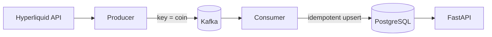

# Funding Pipeline

[](https://github.com/s96488-dev/funding-pipeline/actions/workflows/ci.yml)


A streaming data pipeline that collects perpetual funding rates from the
[Hyperliquid](https://hyperliquid.xyz) exchange every minute, delivers them
through Kafka into PostgreSQL, and serves a funding leaderboard and per-coin
history over a REST API.

## What it does



- **Producer** polls the Hyperliquid API every minute, validates the response
  with Pydantic and publishes one message per asset (~178 assets) to Kafka.
  Transient failures (network errors, HTTP 429/5xx) are retried with
  exponential backoff and jitter.
- **Consumer** reads messages in batches, writes them to PostgreSQL and
  commits Kafka offsets only after the data is stored.
- **API** exposes the data:
  - `GET /leaderboard`: latest funding per coin, annualized, filtered by
    24h volume (`min_volume`, `limit`)
  - `GET /funding/{symbol}`: funding history for one coin (`hours`)
  - `GET /health`: liveness check

### Key design decisions

- **Effectively-once delivery.** Kafka gives at-least-once delivery; writes
  are made idempotent with a composite primary key `(coin_name, timestamp)`
  and `INSERT ... ON CONFLICT DO NOTHING`. Verified by replaying the whole
  topic from the beginning: zero duplicate rows.
- **Ordering per coin.** Messages are keyed by coin, so all snapshots of one
  asset land in the same partition.
- **Index-friendly schema.** The primary key starts with `coin_name`, so
  "history of one coin over a period" is an index range scan.
- **Hourly funding.** Hyperliquid pays funding every hour, so the annualized
  rate is `funding × 24 × 365`.

## How to run

Requirements: [Docker](https://www.docker.com/) and [uv](https://docs.astral.sh/uv/).

```bash
# 1. Configuration
cp .env.example .env            # set your own POSTGRES_PASSWORD

# 2. Infrastructure: Kafka and PostgreSQL
docker compose up -d

# 3. Dependencies and database schema
uv sync
uv run alembic upgrade head

# 4. Pipeline (each in its own terminal)
uv run python -m funding_pipeline.ingestion.producer
uv run python -m funding_pipeline.processing.consumer
uv run uvicorn funding_pipeline.api.main:app
```

Open http://127.0.0.1:8000/docs for the interactive API docs.

## How the tests work

```bash
uv run pytest
```

- **Unit tests** (`tests/unit/`) run without network or database:
  - Pydantic models: type coercion, timezone-aware timestamps, rejection of
    malformed data
  - Exchange response parsing on hand-built payloads: delisted coins are
    skipped, fields are mapped correctly, mismatched lists fail loudly
  - Retry policy: which errors are retried (network, 429, 5xx) and which
    are not (other 4xx)
  - Analytics: annualization, USD open interest, leaderboard filtering and
    sorting
- **Integration tests** (`tests/integration/`) exercise the FastAPI app
  through `TestClient`.

CI (GitHub Actions) runs on every push: `ruff` lint and format check,
`mypy --strict`, the test suite and a Docker image build.

## Tech stack

Python 3.13 · FastAPI · Pydantic · SQLAlchemy Core · Alembic · PostgreSQL ·
Apache Kafka (confluent-kafka) · Pandas · httpx2 · tenacity · Docker Compose ·
pytest · mypy · ruff · uv · GitHub Actions

## Roadmap

- Run producer, consumer and API as Docker Compose services (one-command start)
- Integration tests against a real PostgreSQL via testcontainers
- Deployment on AWS (EC2, RDS, S3 archive, CloudWatch alarms)
- Batch backtesting of funding strategies with PySpark

## License

MIT